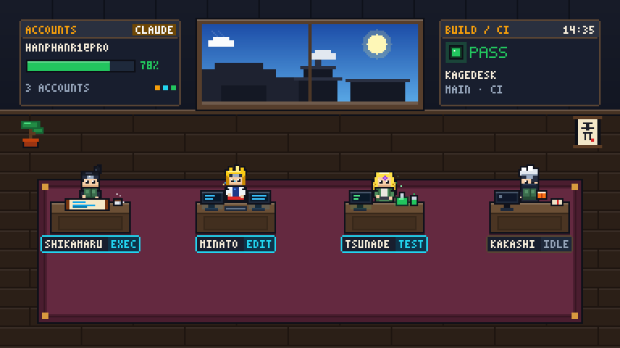
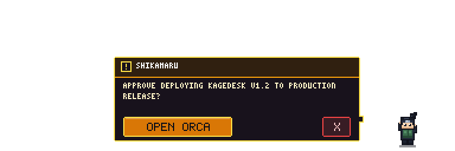
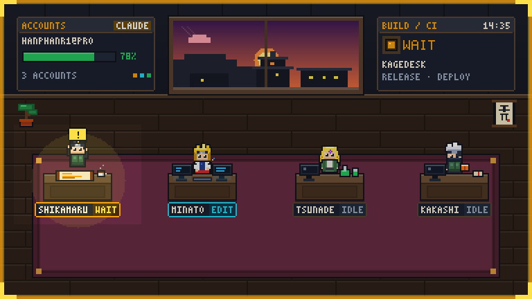
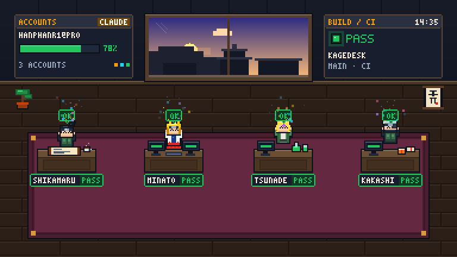
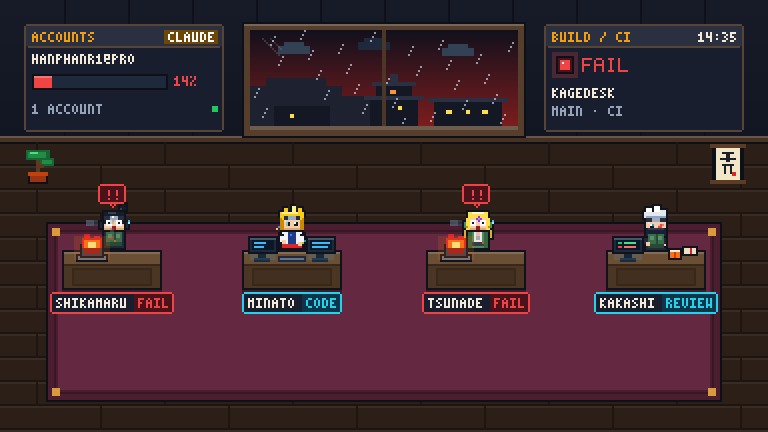
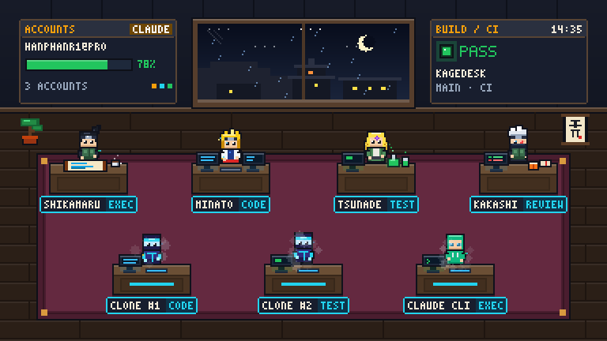
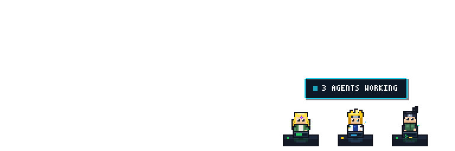
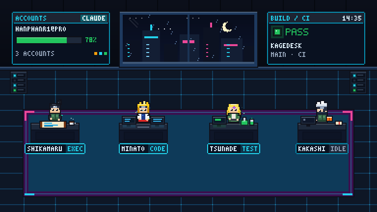
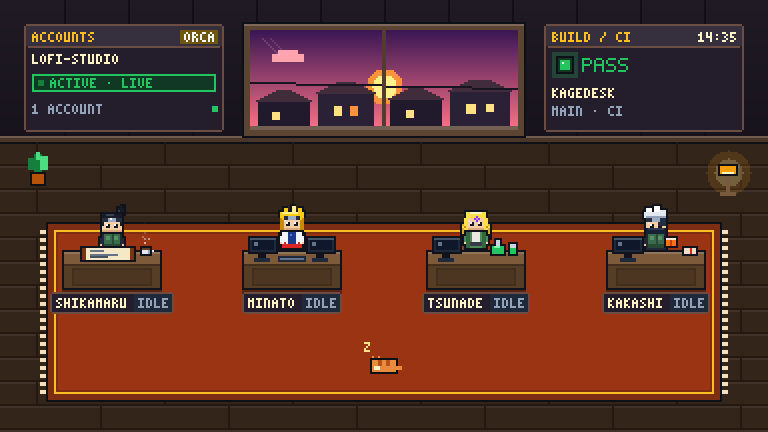

# KageDesk

**Ultra-lightweight native Windows Live Wallpaper & transparent Taskbar Pixel Agent HQ for AI coding agents — ~16 MB private RAM, <0.8% CPU, 0% Chromium**

[](https://github.com/hanphanr1/kagedesk/actions/workflows/ci.yml)
[](https://dotnet.microsoft.com/en-us/download/dotnet/8.0)
[](#architecture--security)
[](LICENSE)

| Live Pixel HQ Wallpaper (`Shinobi HQ`) | Transparent Taskbar Pet Overlay (`Approval Alert`) |
| :---: | :---: |
|  |  |

## KageDesk v2.0 — Living HQ Showcase


KageDesk turns your Windows desktop and taskbar into a live pixel-art command center for your coding agents. Watch agents type at desks, step out and walk across the rug delivering glowing scrolls during live handoffs, track real-time elapsed timers on long tasks, celebrate completed builds with 8-bit retro chimes, wave urgent approval banners, and record lightweight animated GIFs — all rendered natively in pure C# / Win32 GDI without Electron, WebView2, or browser runtimes.

---

## Real Measured Performance

Measured on Windows 11 (Intel Core i5-1145G7) during sustained animated wallpaper + taskbar overlay soak benchmarks (`KageDesk.exe --benchmark`):

| Metric | Measured Result | Notes |
| :--- | :--- | :--- |
| **Private RAM** | **~16–22 MB** | Working Set ~55–57 MB; **0 Electron, 0 WebView2, 0 Chromium** |
| **CPU Usage** | **~0.5% active** | **0.0% wallpaper CPU/GPU** when occluded by maximized or fullscreen apps |
| **Frame Render Time** | **~0.6–0.7 ms/frame** | Persistent 32bpp `CreateDIBSection` + pinned `PixelBuffer` (`PixelFormat.Format32bppPArgb`) |
| **GDI Handle Delta** | **0** (`5 -> 5`) | Zero GDI/USER handle leaks across soak and rapid 1x/2x scale switches |

---

## Live States Showcase

Every agent transition drives distinct pixel animations, lighting moods, and ambient effects across both the desktop wallpaper and the transparent taskbar pet strip:

| Working Squad | Approval Gate Alert |
| :---: | :---: |
|  |  |
| **Done / Celebration** | **Failure / Storm Alert** |
|  |  |
| **Shadow Clones (Multi-Worktree)** | **Taskbar Pet Strip (Working & Approval)** |
|  | <br> |

---

## Swappable JSON Theme Packs

KageDesk ships with three hot-reloadable themes in `themes/`. Switch live from the System Tray menu or drop in your own folder under `themes/<your-theme>/theme.json` and click **Reload Themes**:

| Shinobi HQ (`shinobi-hq`) | Cyber Bunker (`cyber-bunker`) | Cozy Lo-Fi (`cozy-lofi`) |
| :---: | :---: | :---: |
|  |  |  |

### Custom `themes/<id>/theme.json` Schema

Create a new directory `themes/my-hq/theme.json` following this schema:

```json
{
  "id": "my-hq",
  "displayName": "My Custom HQ",
  "version": "1.0.0",
  "author": "your-handle",
  "palette": {
    "background": "#121622",
    "surface": "#1b2234",
    "border": "#584434",
    "accent": "#f59e0b",
    "text": "#f3ead8"
  },
  "weather": {
    "dawn": "#f6b879",
    "day": "#5aa9e6",
    "sunset": "#ea6b3b",
    "midnightRain": "#1a243b",
    "stormAlert": "#7f1d1d"
  },
  "layout": {
    "maxSlots": 8,
    "deskSpacing": 16,
    "slotWidth": 64,
    "slotHeight": 64
  },
  "characters": {
    "shikamaru": { "sprite": "shikamaru", "idleAnimation": "coffee", "workAnimation": "scroll", "alertAnimation": "wave" },
    "minato":    { "sprite": "minato",    "idleAnimation": "idle",   "workAnimation": "flash",  "alertAnimation": "wave" },
    "tsunade":   { "sprite": "tsunade",   "idleAnimation": "idle",   "workAnimation": "flask",  "alertAnimation": "wave" },
    "kakashi":   { "sprite": "kakashi",   "idleAnimation": "book",   "workAnimation": "sharingan", "alertAnimation": "wave" },
    "clone":     { "sprite": "clone",     "idleAnimation": "idle",   "workAnimation": "type",   "alertAnimation": "poof" },
    "generic":   { "sprite": "generic",   "idleAnimation": "idle",   "workAnimation": "type",   "alertAnimation": "wave" }
  },
  "scene": {
    "wallTop": "#171b28",
    "wallBottom": "#121622",
    "floorBase": "#2b1f17",
    "floorLine": "#1e1510",
    "rugOuter": "#4a1d2f",
    "rugInner": "#642940",
    "deskTop": "#6b4f35",
    "deskFront": "#4b3523",
    "windowFrame": "#563e2c",
    "boardBg": "#181e2e",
    "skylineStyle": "konoha"
  }
}
```

Supported `skylineStyle` presets: `konoha`, `cyber`, and `lofi`.

---

## Quickstart & CLI Flags

### Prerequisites
- Windows 10 or Windows 11 (x64)
- [.NET 8 SDK](https://dotnet.microsoft.com/en-us/download/dotnet/8.0)

### Build & Run

```powershell
dotnet build KageDesk.sln -c Release
.\src\KageDesk.App\bin\Release\net8.0-windows\KageDesk.exe
```

### CLI Modes

| Flag | Description |
| :--- | :--- |
| *(no args)* | Starts the full Live Wallpaper + Taskbar Pet Overlay + System Tray Studio |
| `--no-wallpaper` | Runs only the transparent Taskbar Pet Overlay and tray controller |
| `--record-gif <path> [--theme <id>] [--scenario <id>] [--scale 1\|2]` | Records a 6-second auto-choreographed showcase or scenario loop (`showcase`, `handoff`, `working`, `approve`, `done`, `fail`, `clone`) to GIF89a with transparent diff compression |
| `--snapshot <dir>` | Headlessly renders all 9 crisp nearest-neighbor preview PNGs into `<dir>` |
| `--benchmark <seconds> [--out <file>]` | Runs a headless rendering & GDI/RAM soak benchmark for `<seconds>` and optionally writes a JSON/text report |

### System Tray Studio Controls

Right-click the KageDesk tray icon (or right-click the Taskbar Pet strip) for live controls:
- **Live Wallpaper** toggle & active desktop topology status
- **Taskbar Pets**: `Always Chill`, `Auto-Hide on Idle`, `Off`, `1x (384px)` / `2x (768px)` HiDPI scale, drag horizontally along the taskbar, and **Reset Position to Right**
- **Theme Packs**: instant live switching (`Shinobi HQ`, `Cyber Bunker`, `Cozy Lo-Fi`), **Reload Themes**, and **Open Themes Folder**
- **Weather**: `Auto`, `Dawn`, `Day`, `Sunset`, `MidnightRain`, `StormAlert`
- **Demo Studio**: one-click triggers for `Trigger Working Agents`, `Trigger Living Handoff`, `Trigger Needs Approval`, `Trigger Done (Celebration)`, `Trigger Failure Alert`, `Trigger 4 Clones`, `Export 6s Demo GIF...`, and `Reset to Live Orca`
- **Settings**: `Sound Effects (8-bit)` toggle, `Auto-Pause Wallpaper When Covered`, `Hide Pets in Fullscreen Game (DND)`, optional `Process Agent Collector`, optional `GitHub CI Collector`, and `Launch on Windows Startup`

---

## Connecting Any Agent (Orca, Antigravity, OMP, Claude Code, Codex, CI)

### 1. Zero-Config Orca Discovery
When Orca is installed on `PATH`, KageDesk automatically polls live agent activity, worktrees, bots, and account quotas via:
- `orca worktree ps`
- `orca bot list`
- `orca bot item list`
- `orca account list`

No configuration or hooks are required for Orca sessions.

### 2. Local HTTP Event Bridge (`127.0.0.1:4319`)
Any local agent, CLI runner, or CI hook can push real-time status updates to `http://127.0.0.1:4319/api/event`:

- **Authentication**: Protected by a per-install 256-bit hex token stored at `%APPDATA%\KageDesk\bridge.token` with strict current-user-only NTFS ACLs. Pass it in the `X-KageDesk-Token` header.
- **Endpoints**:
  - `GET /api/health` — unauthenticated health/telemetry probe (`ok`, `version`, `workingSetMb`, `uptimeSec`, `activeTheme`, `agentCount`)
  - `GET /api/state` — token-protected allowlisted state DTO
  - `POST /api/event` — token-protected event ingestion (`type`, `state`, `agentId`, `name`, `role`, `toolName`, `message`, `repo`, `buildStatus`, `accountProvider`, `accountName`, `quotaPercent`)
  - `POST /api/demo/{working|approve|done|fail|clone|clear}` — token-protected Demo Studio triggers

### 3. Ready-to-Use Hook Scripts & Claude Code Templates

Emit events directly from PowerShell or Bash (the scripts auto-read `%APPDATA%\KageDesk\bridge.token` and strip UTF-8 BOMs cleanly):

```powershell
# PowerShell (Windows)
pwsh -NoProfile -ExecutionPolicy Bypass -File .\hooks\kagedesk-emit.ps1 `
  -Type tool_start -AgentId claude -Message "Running tests"
```

```bash
# Bash (Git Bash / WSL / macOS / Linux)
bash ./hooks/kagedesk-emit.sh tool_done codex "Build green"
```

Drop-in **Claude Code** hook configurations are included:
- **Bash / Git Bash**: [`hooks/claude-code-hooks.example.json`](hooks/claude-code-hooks.example.json)
- **Windows PowerShell 7 (`pwsh`)**: [`hooks/claude-code-hooks.windows.example.json`](hooks/claude-code-hooks.windows.example.json) — requires **PowerShell 7 (`pwsh`)** on `PATH` (or replace `pwsh` with `powershell.exe` if using Windows PowerShell 5.1)

Both wire `PreToolUse` (`tool_start`), `PostToolUse` (`tool_done`), `Notification` (`notification`), and `Stop` (`idle`) verbatim.

---

## Architecture & Security

- **Dual Desktop Wallpaper Topology**: Supports both **Windows 10 / Win11 <= 23H2 Classic `WorkerW`** and **Windows 11 24H2 / 25H2 Raised Desktop (`Progman` + `SHELLDLL_DefView`)**. Verifies Explorer PID ownership, verifies `GetAncestor(GA_PARENT)` and `GWL_STYLE`/`GWL_EXSTYLE` readback on both rollback and detach, never modifies Windows OS wallpaper registry/SPI settings on detach, and automatically recovers when Explorer restarts (`TaskbarCreated`).
- **Monitor-Aware Auto-Pause & Game DND**: Tracks DWM extended frame bounds and cloaked state on the primary monitor to pause wallpaper rendering at 0% CPU/GPU when covered, plus `SHQueryUserNotificationState` fullscreen DND to hide taskbar pets during games or presentations.
- **Zero-Allocation Native Rendering**: Fixed-size pinned `PixelBuffer` canvases — **`384x216` wallpaper** (nearest-neighbor blit; 2x previews at `768x432`) and **`384x128` taskbar pets** (2x HiDPI / previews at `768x256`). The pet overlay specifically renders through a persistent 32bpp `CreateDIBSection` + `UpdateLayeredWindow` path for crisp per-pixel alpha with zero GDI leaks.
- **Defense-in-Depth Local Bridge**:
  - Strictly bound to `127.0.0.1` loopback with remote address verification, 32 KB body cap (including chunked streams), 16-request concurrency cap, and slow-client read-timeout aborts.
  - Zero-TOCTOU token verification inspects the raw binary NTFS security descriptor (`RawSecurityDescriptor`), enforcing protected DACL inheritance, owner SID match, and current-user-only Allow `CommonAce` entries — failing closed and regenerating on mismatch.
  - Allowlisted `/api/state` public DTO omits `Prompt`, `LastMessage`, `QuestionPrompt`, and event `Message` fields so private prompt/chat contents are never exposed.

---

## Contributing & Verification

```powershell
dotnet restore KageDesk.sln
dotnet build KageDesk.sln -c Release --no-restore --no-incremental
dotnet test KageDesk.sln -c Release --no-build
```

## License

Released under the [MIT License](LICENSE).
